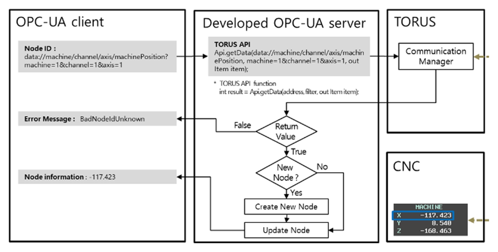
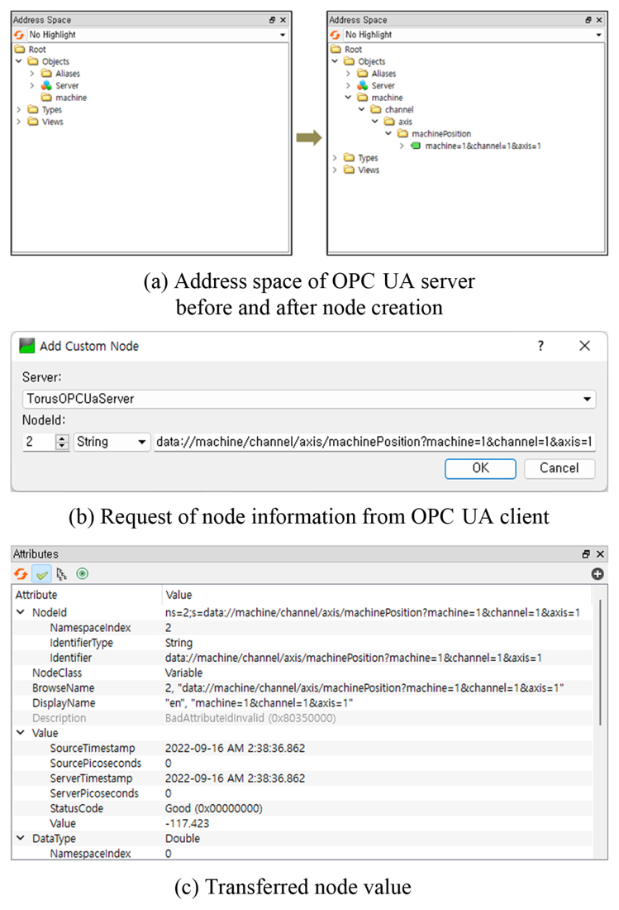

# TORUS Gateway

TORUS(통합 CNC 인터페이스 플랫폼)를 **HTTP REST API** 또는 **OPC UA**로 노출하는 Windows 데스크톱 게이트웨이입니다. TORUS API는 Windows에서 C++/C#으로만 쓸 수 있는데, 이 게이트웨이를 거치면 브라우저, cURL, OPC UA 클라이언트, 다른 OS의 애플리케이션에서도 CNC 데이터를 조회·수정하고 NC 파일을 주고받을 수 있습니다. 두 방식 중 하나를 골라 서버를 엽니다.

이 저장소는 아래 두 논문에서 소개한 프로그램의 구현입니다.

> "The Development of REST API Gateway Application Using Unified CNC Interface Platform," *International Journal of Precision Engineering and Manufacturing-Smart Technology*. https://doi.org/10.57062/ijpem-st.2024.00171
>
> "OPC UA-Based Machining Cell Monitoring System for Multi-Vendors' Machine Tools and Industrial Robots," *International Journal of Precision Engineering and Manufacturing-Smart Technology*, 1(1), 63–69, 2023. https://doi.org/10.57062/ijpem-st.2022.0024

더 이상 유지보수하지 않는 저장소입니다.

## 주소 규칙 (HTTP와 OPC UA 공통)

TORUS 매뉴얼의 Machine Data Model 주소에서 `data:/`를 뗀 문자열 하나를 두 방식에서 똑같이 씁니다.

| | 예 |
|---|---|
| TORUS 주소 | `data://machine/channel/axis/machinePosition?machine=1&channel=1&axis=1` |
| HTTP | `GET http://<host>:5001/machine/channel/axis/machinePosition?machine=1&channel=1&axis=1` |
| OPC UA NodeId | `ns=2;s=/machine/channel/axis/machinePosition?machine=1&channel=1&axis=1` |

사용할 수 있는 모델 주소와 필터는 TORUS 매뉴얼을 참고하십시오. 쿼리의 키 순서나 대소문자는 정규화하지 않으므로, 같은 데이터라도 다르게 쓰면 다른 주소로 취급합니다.

## HTTP (REST)


URL의 경로는 TORUS 모델 주소로, 쿼리스트링은 필터로 바뀌고, 게이트웨이는 `Api.getData(주소, 필터)` 결과를 가공 없이 반환합니다.


| 기능 | 요청 | TORUS 호출 |
|---|---|---|
| 데이터 조회 | `GET /machine/{모델 주소}?{필터}` | `Api.getData` |
| 데이터 수정 | `PUT /machine/{모델 주소}?{필터}` + JSON body | `Api.updateData` |
| 파일 받기 | `GET /file/machine/ncpath?machine={ID}&ncpath={CNC 경로}` | `Api.DownloadFile` |
| 파일 올리기 | `PUT /file/machine/ncpath?machine={ID}&ncpath={CNC 경로}` + multipart `file` | `Api.UploadFile` |
| 파일 삭제 | `DELETE /file/machine/ncpath?machine={ID}&ncpath={CNC 경로}` | `Api.CNCFileDelete` |
| 머신 목록 | `GET /machineList` | `Api.getMachinesInfo` |
| 상태 확인 | `GET /` → `{"status":"ok"}`, `GET /health` → `{"status":0,"value":"ok"}` | 없음 |

### 데이터 조회

```bash
curl "http://localhost:5001/machine/channel/axis/machinePosition?machine=1&channel=1&axis=1-3"
```
```json
{
  "value": [84.81207, -14.17339, 159.56296],
  "status": 0,
  "datatype": "double",
  "time": "2024-09-08T23:42:27.730",
  "address": "data://machine/channel/axis/machineposition",
  "filter": "machine=1&channel=1&axis=1-3"
}
```

### 데이터 수정

body는 TORUS Item 형식이며 `value`는 비어 있지 않은 배열이어야 합니다. 형식이 다르면 게이트웨이가 400으로 거부하고 TORUS로 넘기지 않습니다. TORUS v2.3.3은 `{"value":12.34}`처럼 배열이 아닌 값을 받으면 통신 매니저(`mgrCommunication`)가 종료되어 연결된 모든 설비와의 통신이 끊기기 때문입니다.

```bash
curl -X PUT "http://localhost:5001/machine/channel/variable/userVariable?machine=1&channel=1&variable=2" \
     -H "Content-Type: application/json" -d '{"value":[12.34]}'
```
```json
{"status":0}
```


### 파일 전송

TORUS는 게이트웨이 PC의 로컬 경로로만 파일을 주고받습니다. 그래서 게이트웨이가 요청마다 임시 디렉토리를 거쳐 전달합니다.

```bash
# 올리기
curl -X PUT "http://localhost:5001/file/machine/ncpath?machine=1&ncpath=//NC/Partprograms/TEST.MPF" \
     -H "Content-Type: multipart/form-data" -F "file=@TEST.MPF"
# 받기
curl -O "http://localhost:5001/file/machine/ncpath?machine=1&ncpath=//NC/Partprograms/TEST.MPF"
# 삭제
curl -X DELETE "http://localhost:5001/file/machine/ncpath?machine=1&ncpath=//NC/Partprograms/TEST.MPF"
```


### 오류 응답

- 게이트웨이가 거부한 요청: `{"status":-1,"error":"<설명>"}`, HTTP 400/404/500
- 파일 전송 중 TORUS 호출 실패: `{"status":<TORUS 코드>,"error":"<설명>"}`, HTTP 502
- 데이터 조회·수정은 TORUS의 `status`를 그대로 담아 HTTP 200으로 반환합니다.

## OPC UA

서버는 `Objects/machine` 폴더만 있는 빈 주소 공간으로 시작합니다. 클라이언트가 위 주소 규칙의 NodeId를 요청하면 서버가 TORUS `getData`를 호출하고, 성공할 때만 그 자리에서 노드를 만듭니다. 실패하면 `BadNodeIdUnknown`을 돌려줍니다. 만들어진 노드는 경로가 폴더, 필터가 변수 이름인 트리로 브라우즈할 수 있습니다.



논문에서는 NodeId에 `data://`를 붙였지만(그림 2·3), 이후 HTTP와 같은 주소를 쓰도록 `data:/`를 뺐습니다. OPC UA에서는 네임스페이스(`ns=2`)가 이미 TORUS 데이터임을 나타내기 때문입니다.



논문 표 1의 예시를 현재 NodeId 형식으로 옮기면 다음과 같습니다.

| NodeId (`ns=2;s=` 뒤) | 타입 | 설명 |
|---|---|---|
| `/machine/channel/axis/machinePosition?machine=1&channel=1&axis=1` | Double | X축 기계 좌표 |
| `/machine/channel/axis/workPosition?machine=1&channel=1&axis=1-3` | Double[] | X·Y·Z 공작물 좌표 |
| `/machine/channel/spindle/rpm/actualSpeed?machine=1&channel=1&spindle=1` | Double | 주축 실제 회전수 |
| `/machine/channel/feed/feedRate/actualSpeed?machine=1&channel=1` | Double | 실제 이송 속도 |
| `/machine/channel/currentProgram/currentBlock?machine=1&channel=1` | String | 현재 실행 블록 |
| `/machine/channel/currentProgram/currentFile/programName?machine=1&channel=1` | String | 현재 프로그램 이름 |

### 데이터 타입

| TORUS `datatype` | OPC UA | 배열 |
|---|---|---|
| `string` / `long` / `double` / `boolean` | String / Int64 / Double / Boolean | 값이 2개 이상이면 1차원 배열, 하나면 스칼라 |
| `liststring` / `listlong` / `listdouble` / `listboolean` | 위와 같음 | 항상 1차원 배열 |

그 밖의 타입은 노드를 만들지 않습니다.

### 읽기, 쓰기, 구독

- **읽기:** 읽을 때마다 TORUS를 호출합니다. 구독 중인 노드는 아래 주기 갱신 값을 돌려줍니다.
- **쓰기:** Username 인증으로 접속했을 때만 가능합니다. 익명 접속은 읽기·구독만 할 수 있고 쓰면 `BadUserAccessDenied`입니다. 노드의 타입·배열 여부와 같은 값만 받고(다르면 `BadTypeMismatch`), 항상 `{"value":[...]}` 배열로 만들어 TORUS `updateData`로 보냅니다. 빈 배열은 보내지 않습니다. 부분 쓰기(IndexRange)는 지원하지 않습니다.
- **구독:** 구독 중인 노드만 TORUS에서 주기적으로 다시 읽어, 값이나 상태가 바뀌었을 때 알립니다. 주기는 `config.ini`의 `[OpcUa] PollIntervalMs`(기본 100ms)입니다. 모든 TORUS 호출은 하나씩 순서대로 처리되므로, 구독 노드가 많으면 한 바퀴가 그만큼 길어집니다.

### 보안

메인 창에서 엔드포인트, 보안 정책·모드, 인증 방식을 고릅니다.

- **보안 정책:** None, Basic256Sha256, Aes128_Sha256_RsaOaep, Aes256_Sha256_RsaPss. None이면 모드도 None이고, 그 외에는 Sign 또는 SignAndEncrypt입니다.
- **인증:** Anonymous 또는 Username 중 하나만 허용합니다. 익명은 읽기 전용이라, 기본 설정(익명, 보안 없음)으로 열어도 네트워크에서 CNC 값을 바꿀 수 없습니다. 값을 써야 하면 Username을 쓰십시오. 보안 정책이 None이어도 사용자 이름 토큰은 자체 암호화(Basic256Sha256)해 비밀번호가 평문으로 오가지 않습니다. 비밀번호는 현재 Windows 사용자 계정으로 암호화해 `config.ini`에 저장합니다.
- **인증서:** 서버 인증서는 처음 시작할 때 자체 서명으로 만들어 실행 파일 폴더의 `pki/own`에 둡니다. 클라이언트 인증서는 기본적으로 신뢰하지 않습니다. 처음 접속한 클라이언트의 인증서는 `pki/rejected/certs`에 쌓이고, 이를 `pki/trusted/certs`로 옮기면 서버를 재시작하지 않아도 바로 허용됩니다. 메인 창의 **Certificates** 버튼이 이 폴더를 엽니다. **Auto-accept client certificates**를 켜면 모든 클라이언트 인증서를 받습니다.
  서버 인증서는 처음 시작한 엔드포인트 주소와 PC 이름으로 만들어집니다. 엔드포인트 주소(예: `0.0.0.0` → 특정 IP)나 PC 이름을 바꾸면 서버가 인증서를 새로 만들고 로그에 남깁니다. 이때 서버 인증서를 신뢰해 두었던 클라이언트는 새 인증서를 다시 신뢰해야 합니다.

## HTTP 보안

- **접근 IP 제한:** 메인 창에서 Allow All / Local Only / Specify IPs(단일 IP·CIDR)를 고릅니다. 서버 실행 중에도 바로 반영됩니다.
- **CORS 미설정:** 브라우저의 cross-origin 호출을 막아 악성 웹페이지를 통한 요청을 차단합니다. cURL이나 서버 측 호출은 영향받지 않습니다.
- **필터 조작 방지:** 디코딩된 경로·쿼리 키·값에 `?`, `&`, `=`가 들어 있으면 400으로 거부합니다. 예를 들어 `machine=1%26machine%3D2`로 대상 설비를 바꾸는 요청을 막습니다.
- **TORUS 보호:** PUT body는 `{"value":[...]}` 형식만 TORUS로 넘깁니다(위 "데이터 수정" 참고).
- **경로 조작 방지:** `ncpath`에 `..`이 있으면 거부합니다.
- **업로드 크기:** 100MB까지 받습니다.

HTTP에는 인증이 없습니다. 신뢰할 수 있는 내부망에서만 사용하십시오.

## 요구 사항

- Windows, .NET 8
- TORUS v2.3.3 설치 및 실행, CNC 연결 완료 (TORUS가 CNC에 먼저 연결된 뒤 게이트웨이가 TORUS에 연결합니다)
- **x86 빌드 필수:** TORUS 네이티브 DLL이 32비트입니다.

`TorusApi/`에는 TORUS SDK v2.3.3(`Example/Api`)의 DLL 중 게이트웨이가 실제로 쓰는 14개만 들어 있습니다. OPC UA는 OPC Foundation의 공식 .NET 스택(`OPCFoundation.NetStandard.Opc.Ua.Server`, MIT 라이선스)을 NuGet으로 받습니다.

## 사용법

1. **TORUS Connect**로 TORUS에 연결합니다. 실패하면 버튼이 Reconnect로 바뀌고, 누르면 앱을 재시작해 다시 연결합니다. TORUS API에는 연결 해제가 없어 재연결하려면 프로세스를 다시 띄워야 합니다.
2. **Protocol**에서 HTTP (REST) 또는 OPC UA를 고르고 설정을 정합니다.
   - HTTP: Host/Port(기본 `0.0.0.0:5001`)와 접근 IP
   - OPC UA: 엔드포인트(기본 `opc.tcp://0.0.0.0:4840`), 보안 정책·모드, 인증
3. **Server Open**을 누릅니다. 한 번에 하나의 프로토콜만 실행합니다.
4. HTTP는 **Test Request**로 GET/PUT/DELETE 요청을 바로 보내 볼 수 있습니다.

그 밖에 **TORUS Settings**에서 TORUS의 `MachineList.xml`을 편집합니다. HTTP 요청 로그는 메인 창에서 주기적 GET, 간헐적 GET, PUT/DELETE로 나눠 보여주고, OPC UA에서는 노드 생성·쓰기·거부 같은 서버 이벤트를 보여줍니다. HTTP 4xx/5xx 응답은 `logs/yyyy-MM-dd.log`에도 남습니다(`config.ini`의 `[Logging] MaxTotalMB`, 기본 50MB).

## 빌드 / Build

```bash
dotnet build TorusGateway.sln -c Release
dotnet test TorusGateway.Tests/TorusGateway.Tests.csproj
```

빌드할 때 `TorusApi/*.dll`과 `TorusGateway.info`가 출력 디렉토리로 복사됩니다. 설정(`config.ini`), 로그(`logs/`), OPC UA 인증서(`pki/`)는 모두 실행 파일 폴더에 생깁니다.

## 프로젝트 구조

```
TorusGateway/
  App.xaml(.cs)               # 단일 인스턴스, 종료 시 임시 디렉토리 정리
  MainWindow.xaml(.cs)        # 연결, 프로토콜 선택, 서버 시작/종료, 접근 IP, 로그, 트레이
  TestRequestWindow.xaml(.cs) # GET/PUT/DELETE 테스터
  ConfigManager.cs            # config.ini 읽기/쓰기
  Torus/
    Torus.cs                  # TORUS API 래퍼 (싱글턴, 모든 호출 직렬화)
    MachineListControl/Window # MachineList.xml 편집기
  WebServer/                  # HTTP
    WebServer.cs              # ASP.NET Core 호스트, IP 허용목록·요청 로그 미들웨어
    MachineController.cs      # /machine/*, /machineList, /, /health
    FileController.cs         # /file/machine/ncpath
    TorusStatusCodes.cs       # TORUS 오류 코드 → 설명
    FileLogger.cs             # 4xx/5xx 파일 로그
  OpcUa/                      # OPC UA
    OpcUaHost.cs              # 설정·인증서 준비, 서버 시작/종료
    TorusOpcUaServer.cs       # 서버 정보, 사용자 인증
    TorusNodeManager.cs       # 동적 노드 생성, 읽기·쓰기, 구독 주기 갱신
    OpcUaValues.cs            # NodeId ↔ TORUS 주소, TORUS Item ↔ OPC UA 값 변환
    OpcUaSettings.cs          # 설정 검증, config.ini 저장 (비밀번호 암호화)
TorusGateway.Tests/           # xUnit
TorusApi/                     # TORUS SDK v2.3.3 DLL
docs/                         # 논문 그림
```

그림 출처: 위 두 논문 (CC BY-NC 4.0).
