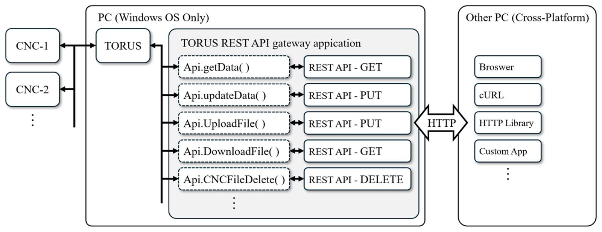
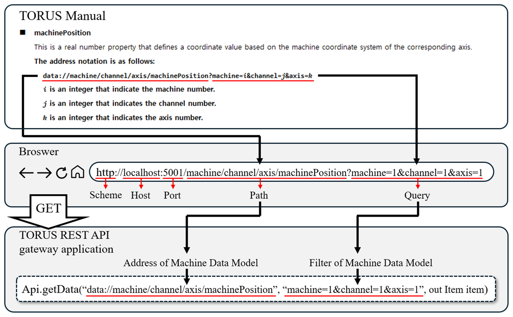
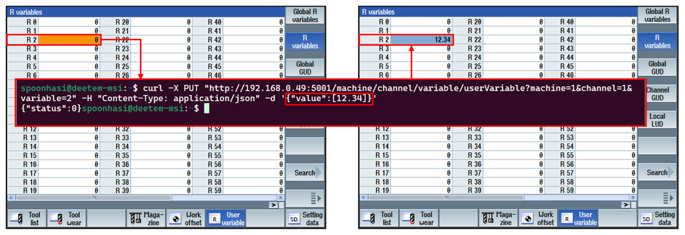
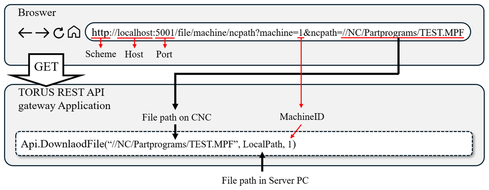
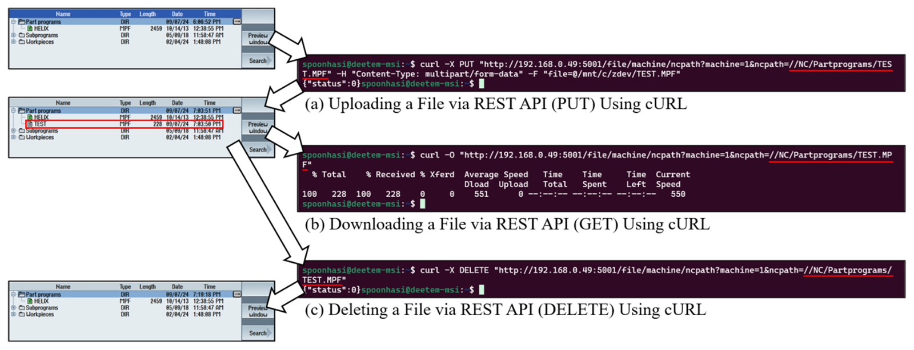

# TORUS Gateway

TORUS(통합 CNC 인터페이스 플랫폼)를 HTTP REST API로 노출하는 Windows 데스크톱 게이트웨이입니다. TORUS API는 Windows에서 C++/C#으로만 쓸 수 있는데, 이 게이트웨이를 거치면 브라우저, cURL, 다른 OS의 애플리케이션에서도 CNC 데이터를 조회·수정하고 NC 파일을 주고받을 수 있습니다.

이 저장소는 아래 논문에서 소개한 프로그램의 구현입니다.

> Yeong-Deuk Kim, Dong Yoon Lee, "The Development of REST API Gateway Application Using Unified CNC Interface Platform," *International Journal of Precision Engineering and Manufacturing-Smart Technology*. https://doi.org/10.57062/ijpem-st.2024.00171

더 이상 유지보수하지 않는 저장소입니다. v2.0.0은 논문의 설계에 맞춰 정리한 최종 버전입니다.



## 동작 방식

TORUS 매뉴얼의 Machine Data Model 주소를 URL로 그대로 옮깁니다. 스킴 `data`는 `http`로, 모델 주소는 경로로, 필터는 쿼리스트링으로 바뀝니다. 게이트웨이는 이를 다시 `Api.getData(주소, 필터)` 호출로 되돌리고, TORUS 결과를 가공 없이 반환합니다.



## API

| 기능 | 요청 | TORUS 호출 |
|---|---|---|
| 데이터 조회 | `GET /machine/{모델 주소}?{필터}` | `Api.getData` |
| 데이터 수정 | `PUT /machine/{모델 주소}?{필터}` + JSON body | `Api.updateData` |
| 파일 받기 | `GET /file/machine/ncpath?machine={ID}&ncpath={CNC 경로}` | `Api.DownloadFile` |
| 파일 올리기 | `PUT /file/machine/ncpath?machine={ID}&ncpath={CNC 경로}` + multipart `file` | `Api.UploadFile` |
| 파일 삭제 | `DELETE /file/machine/ncpath?machine={ID}&ncpath={CNC 경로}` | `Api.CNCFileDelete` |
| 머신 목록 | `GET /machineList` | `Api.getMachinesInfo` |
| 상태 확인 | `GET /` → `{"status":"ok"}`, `GET /health` → `{"status":0,"value":"ok"}` | 없음 |

사용할 수 있는 모델 주소와 필터는 TORUS 매뉴얼을 참고하십시오.

### 데이터 조회

```bash
curl "http://192.168.0.49:5001/machine/channel/axis/machinePosition?machine=1&channel=1&axis=1-3"
```
```json
{
  "value": [84.81207, -14.17339, 159.56296],
  "status": 0,
  "datatype": "double",
  "time": "2024-09-08T23:42:27.730",
  "address": "data://machine/channel/axis/machineposition",
  "filter": "machine=1&channel=1&axis=1-3"
}
```

### 데이터 수정

body는 TORUS Item 형식이며 `value`는 비어 있지 않은 배열이어야 합니다. 형식이 다르면 게이트웨이가 400으로 거부하고 TORUS로 넘기지 않습니다. TORUS v2.3.3은 `{"value":12.34}`처럼 배열이 아닌 값을 받으면 통신 매니저(`mgrCommunication`)가 종료되어 연결된 모든 설비와의 통신이 끊기기 때문입니다.

```bash
curl -X PUT "http://192.168.0.49:5001/machine/channel/variable/userVariable?machine=1&channel=1&variable=2" \
     -H "Content-Type: application/json" -d '{"value":[12.34]}'
```
```json
{"status":0}
```



### 파일 전송

TORUS는 게이트웨이 PC의 로컬 경로로만 파일을 주고받습니다. 그래서 게이트웨이가 요청마다 임시 디렉토리를 거쳐 전달합니다.

```bash
# 올리기
curl -X PUT "http://192.168.0.49:5001/file/machine/ncpath?machine=1&ncpath=//NC/Partprograms/TEST.MPF" \
     -H "Content-Type: multipart/form-data" -F "file=@TEST.MPF"
# 받기
curl -O "http://192.168.0.49:5001/file/machine/ncpath?machine=1&ncpath=//NC/Partprograms/TEST.MPF"
# 삭제
curl -X DELETE "http://192.168.0.49:5001/file/machine/ncpath?machine=1&ncpath=//NC/Partprograms/TEST.MPF"
```




### 오류 응답

- 게이트웨이가 거부한 요청: `{"status":-1,"error":"<설명>"}`, HTTP 400/404/500
- 파일 전송 중 TORUS 호출 실패: `{"status":<TORUS 코드>,"error":"<설명>"}`, HTTP 502
- 데이터 조회·수정은 TORUS의 `status`를 그대로 담아 HTTP 200으로 반환합니다.

## 보안

- **접근 IP 제한:** 메인 창에서 Allow All / Local Only / Specify IPs(단일 IP·CIDR)를 고릅니다. 서버 실행 중에도 바로 반영됩니다.
- **CORS 미설정:** 브라우저의 cross-origin 호출을 막아 악성 웹페이지를 통한 요청을 차단합니다. cURL이나 서버 측 호출은 영향받지 않습니다.
- **필터 조작 방지:** 디코딩된 경로·쿼리 키·값에 `?`, `&`, `=`가 들어 있으면 400으로 거부합니다. 예를 들어 `machine=1%26machine%3D2`로 대상 설비를 바꾸는 요청을 막습니다.
- **TORUS 보호:** PUT body는 `{"value":[...]}` 형식만 TORUS로 넘깁니다(위 "데이터 수정" 참고).
- **경로 조작 방지:** `ncpath`에 `..`이 있으면 거부합니다.
- **업로드 크기:** 100MB까지 받습니다.

인증은 없습니다. 신뢰할 수 있는 내부망에서만 사용하십시오.

## 요구 사항

- Windows, .NET 8
- TORUS v2.3.3 설치 및 실행, CNC 연결 완료 (TORUS가 CNC에 먼저 연결된 뒤 게이트웨이가 TORUS에 연결합니다)
- **x86 빌드 필수:** TORUS 네이티브 DLL이 32비트입니다.

`TorusApi/`에는 TORUS SDK v2.3.3(`Example/Api`)의 DLL 중 게이트웨이가 실제로 쓰는 14개만 들어 있습니다.

## 사용법

1. **TORUS Connect**로 TORUS에 연결합니다. 실패하면 버튼이 Reconnect로 바뀌고, 누르면 앱을 재시작해 다시 연결합니다. TORUS API에는 연결 해제가 없어 재연결하려면 프로세스를 다시 띄워야 합니다.
2. Host/Port(기본 `0.0.0.0:5001`)와 접근 IP를 정하고 **WebServer Open**을 누릅니다.
3. **Test Request**로 GET/PUT/DELETE 요청을 바로 보내 볼 수 있습니다.

그 밖에 **TORUS Settings**에서 TORUS의 `MachineList.xml`을 편집하고, 요청 로그는 메인 창에서 주기적 GET, 간헐적 GET, PUT/DELETE로 나눠 보여줍니다. 4xx/5xx 응답은 `logs/yyyy-MM-dd.log`에도 남습니다(`config.ini`의 `[Logging] MaxTotalMB`, 기본 50MB).

## 빌드 / Build

```bash
dotnet build TorusGateway.sln -c Release
dotnet test TorusGateway.Tests/TorusGateway.Tests.csproj
```

빌드할 때 `TorusApi/*.dll`과 `TorusGateway.info`가 출력 디렉토리로 복사됩니다.

## 프로젝트 구조

```
TorusGateway/
  App.xaml(.cs)               # 단일 인스턴스, 종료 시 임시 디렉토리 정리
  MainWindow.xaml(.cs)        # 연결, 웹서버 시작/종료, 접근 IP, 요청 로그, 트레이
  TestRequestWindow.xaml(.cs) # GET/PUT/DELETE 테스터
  ConfigManager.cs            # config.ini 읽기/쓰기
  Torus/
    Torus.cs                  # TORUS API 래퍼 (싱글턴, 모든 호출 직렬화)
    MachineListControl/Window # MachineList.xml 편집기
  WebServer/
    WebServer.cs              # ASP.NET Core 호스트, IP 허용목록·요청 로그 미들웨어
    MachineController.cs      # /machine/*, /machineList, /, /health
    FileController.cs         # /file/machine/ncpath
    TorusStatusCodes.cs       # TORUS 오류 코드 → 설명
    FileLogger.cs             # 4xx/5xx 파일 로그
TorusGateway.Tests/           # xUnit
TorusApi/                     # TORUS SDK v2.3.3 DLL
docs/                         # 논문 그림
```

그림 출처: 위 논문 (CC BY-NC 4.0).
